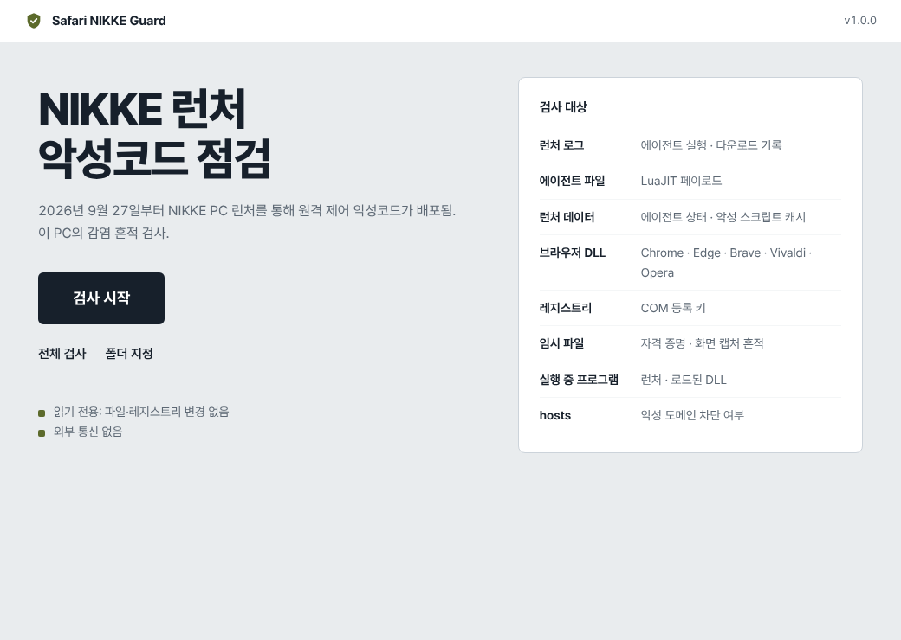
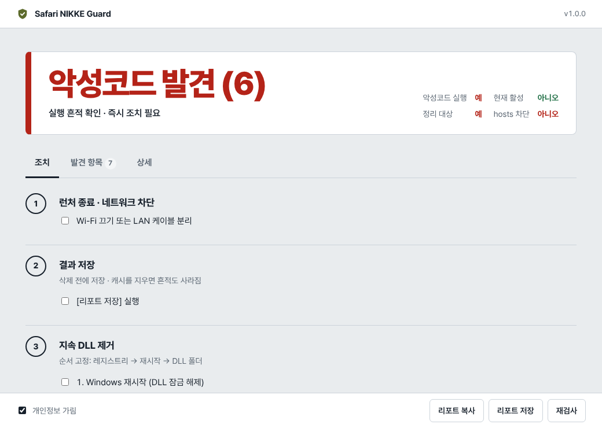
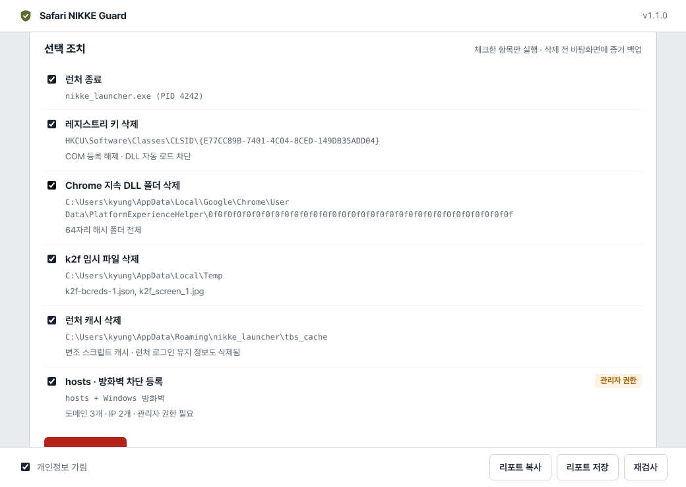

# Safari NIKKE Guard

NIKKE PC 런처 악성코드 점검기 (Windows 10/11)

2026-09-27 ~ 2026-11-04, Level Infinite CDN의 런처 파일 4개가 변조되어 NIKKE PC 런처로 원격 제어 에이전트가 배포됨. 이 프로그램은 그 흔적을 검사하고 판정 결과에 맞는 조치 단계를 표시함.

- **검사는 읽기 전용**: 파일 · 레지스트리 변경 없음
- **조치는 선택한 항목만**: 체크 → 확인 창 → 실행, 삭제 전 증거 백업
- **외부 통신 없음**: 네트워크 코드 없음
- **소스 공개 · 자동 빌드**: exe는 GitHub Actions가 태그 소스로 빌드

<p>
  
  
</p>

## 다운로드

[Releases](https://github.com/ppin-gu/safari-nikke/releases/latest)에서 `SafariNikkeGuard.exe` 다운로드. 설치 불필요.

SHA-256 확인 (PowerShell):

```powershell
Get-FileHash .\SafariNikkeGuard.exe
```

결과를 릴리스의 `SHA256SUMS.txt` 값과 비교.

서명 없는 exe라 SmartScreen 경고가 뜸: **추가 정보 → 실행**.

## 사용법

| 버튼 | 범위 |
|---|---|
| 검사 시작 | 런처 기록 경로 + 모든 드라이브 5단계 깊이 |
| 전체 검사 | 모든 드라이브 전체 |
| 폴더 지정 | 선택한 폴더 |

결과 화면 탭:

- **조치**: 판정에 해당하는 단계만, 순서대로. 경로 복사 · 위치 열기 · 명령 복사 · QR
- **발견 항목**: 치명 / 경고 / 정보
- **상세**: 타임라인, 유출 가능 정보, hosts 차단 상태, 검사 위치

## 선택 조치 (v1.1)

조치 탭 상단에서 항목 체크 후 **선택 항목 조치** → 확인 창 → 실행.



| 항목 | 동작 | 조건 |
|---|---|---|
| 런처 종료 | `nikke_launcher.exe` 종료 | 실행 직전 프로세스 이름 재확인 |
| 레지스트리 키 삭제 | `HKCU\Software\Classes\CLSID\{E77CC89B-…}` 삭제 | 고정 키만 |
| 지속 DLL 폴더 삭제 | `…\PlatformExperienceHelper\<64자리>` 삭제 | 레지스트리 키 삭제 후에만. DLL 사용 중이면 **재시작 후**로 보류 |
| k2f 임시 파일 삭제 | `%TEMP%`에서 `k2f`로 시작하는 항목만 | Temp 폴더만 |
| 런처 캐시 삭제 | `nikke_launcher\tbs_cache` 삭제 | 런처 종료 상태에서만 |
| hosts · 방화벽 차단 | hosts에 도메인 3개, 방화벽 아웃바운드 규칙 IP 2개 | 관리자 권한(UAC) |

- 실행 순서 고정: 런처 종료 → 증거 백업 → 레지스트리 → DLL → 임시 파일 → 캐시 → 차단
- 대상은 실행 직전에 검사 패턴으로 다시 검증, 다르면 실행 안 함
- 앱은 마지막 검사 결과로 만든 목록 안의 항목만 실행 (화면에서 경로를 바꿔 보낼 수 없음)
- 증거 백업: 바탕화면 `니케점검_백업_<시각>\` (리포트, 로그 사본, DLL · 수집 파일은 이름 · SHA-256만 기록)
- 재시작 후 보류 항목은 `%LOCALAPPDATA%\io.github.ppin-gu.safari-nikke-guard\pending.json`에 저장, 다음 실행 시 시작 화면에 **남은 조치 실행** 표시
- 삭제한 파일은 휴지통에 남지 않음

리포트 저장 · 복사 시 **개인정보 가림**(기본 켜짐): PC 이름, 사용자 이름, 프로필 경로, 에이전트 ID 치환.

## 판정

| 판정 | 기준 |
|---|---|
| 악성코드 발견 | 치명 항목 1개 이상 |
| 노출 | 경고 항목만 |
| 흔적 없음 | NIKKE 있음, 의심 항목 없음 (미탐지 ≠ 안전 보장) |
| NIKKE 미설치 | 설치 폴더 · 런처 데이터 없음 |

10/23 이후 런처 사용 기록이 있으면 판정과 무관하게 비밀번호 변경 표시.

## 검사 항목

| 항목 | 위치 | 등급 |
|---|---|---|
| 에이전트 실행 기록 (`k2f_chan`) | `Launcher\intl_service\debug.log` | 치명 |
| 에이전트 다운로드 (`insight.bundle`, `analytics.insightjs.com`) | `Launcher\log\` | 치명 |
| 에이전트 파일 (LuaJIT 바이트코드) | `Launcher\log\` | 치명 |
| 에이전트 상태 (`k2f.agent.state`) | `%APPDATA%\nikke_launcher\tbs_cache` | 치명 |
| 에이전트 서버 접속 (HSTS, Network Persistent State) | 런처 데이터 | 치명 |
| 지속 DLL (`PlatformExperienceHelper\<64자리>\`) | Chrome · Edge · Brave · Vivaldi · Opera · Opera GX · Chromium | 치명 |
| 구버전 지속 파일 | `Chrome\Application\PlatformExperienceHelper` | 치명 |
| COM 등록 키 · 빈 잔여 키 | `HKCU\Software\Classes\CLSID\{E77CC89B-7401-4C04-8CED-149DB35ADD04}` | 치명 |
| 임시 파일 (`k2f*`) | `%TEMP%` | 치명 |
| 런처 실행 중 · 지속 DLL 로드됨 | 프로세스 목록 | 치명 |
| 악성 스크립트 캐시 · 악성 도메인 접속 | 런처 데이터 | 경고 |
| hosts 차단 여부 | `hosts` | 정보 |
| 유출 가능 정보 (저장 로그인, 지갑 확장 28종, SSH 키 · 토큰) | 사용자 프로필 (존재 여부만, 파일 열지 않음) | 정보 |

정상으로 제외: HKLM의 같은 CLSID (`wpc.dll`), Chrome 자체 `platform_experience_helper.exe`.

## 한계

- 에이전트가 실행한 원격 명령은 로그가 없어 확인 불가
- NIKKE 삭제 · 재설치 시 `debug.log`, 다운로드 로그 삭제됨
- 공격자가 흔적을 지웠거나 새 변종이면 미탐지 가능
- 악성코드 발견 시 가장 확실한 조치: Windows 재설치

## 빌드

```
cargo test -p sng-core                       # 검사 엔진 테스트 (모든 OS)
cargo build --release -p safari-nikke-guard  # 앱 (Windows)
cargo run --example scan -- --json           # 명령줄 검사
```

구조:

```
core/   검사 엔진 (sng-core, 읽기 전용) + remedy (선택 조치)
app/    Tauri 앱 (검사, 리포트, 선택 조치, 재시작 후 조치)
ui/     화면 (HTML/CSS/JS, Pretendard 폰트 내장)
```

릴리스: `git tag v1.1.0 && git push origin v1.1.0` → Actions가 빌드 후 Releases에 exe와 SHA-256 첨부.

## 출처 · 라이선스

- 검사 규칙과 IOC: [MotherSphere/NIKKE-Launcher-Check](https://github.com/MotherSphere/NIKKE-Launcher-Check) (GPL-3.0)와 그 분석 문서
- 폰트: [Pretendard](https://github.com/orioncactus/pretendard) (SIL OFL 1.1, `ui/fonts/Pretendard-LICENSE.txt`)
- 이 프로그램: GPL-3.0-or-later ([LICENSE](LICENSE))
